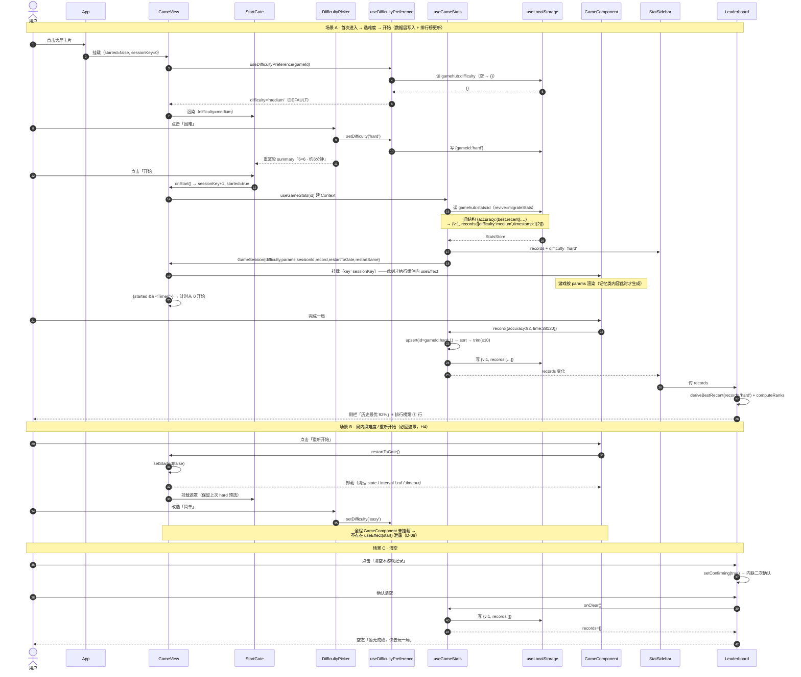
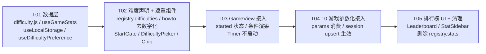

# 增量架构设计：难度选择 / 排行榜 / 开始前遮罩

| 项目信息 | 内容 |
| --- | --- |
| 项目 | `game-hub`（增量改造，v1.0 已上线） |
| 依据 | `docs/PRD-增量-难度与排行榜.md`（许清楚·产品经理）+ 用户已拍板硬约束 |
| 语言 | JavaScript（JSX），无 TS |
| 技术栈 | Vite 5 + React 18 + Tailwind CSS 3，**不新增任何 npm 依赖** |
| 撰写 | 高见远（Gao）· 架构师 |
| 产出文件 | `docs/ARCH-增量-难度与排行榜.md`（本文）、`docs/class-diagram.mermaid`、`docs/sequence-diagram.mermaid` |

---

## 0.1 实现状态：✅ 已实现（2026- 由 寇豆码（Kou）· 工程师 落地）

**构建验证**：`vite build` 通过，`56 modules transformed`（基线 50，新增 6 个模块 = `difficulty.js` + 5 个新组件/hook），无 error / warning。

**全局一致性审查结论：`IS_PASS: YES`**（10 款游戏全部声明并消费三档难度；无「定义了 difficulties 但游戏没消费」的空挂；遮罩期游戏组件确实未挂载；`registry.stats` 已清理干净；`howto` 文案已无写死数字）。

### 与本文档的落地偏差（4 处，均为实施期间的显式决策）

| # | 偏差 | 原因 |
| --- | --- | --- |
| 1 | **§2.3 / §2.4 的 `id` 构造改为由 `useGameStats` 内部拼装**：`record(vals, { sessionKey, difficulty })`，Context 侧的 `sessionId` 仍按 `${gameId}:${difficulty}:${sessionKey}` 生成 | `useGameStats` 内部只有 `gameId`，拿不到 `sessionKey` 字符串。改为显式传 `sessionKey` 数字后由内部拼 id，语义等价且游戏组件侧仍然零改动 |
| 2 | **§3.3 simon 的追加步实现为 `sampleUniqueExcluding(n, inc, s)`**（新增工具函数） | 原文只说「`sampleUnique(PADS.length, inc)`」会与 `s` 已有 pad 重复导致同色相邻。`sampleUniqueExcluding` 才能真正满足「追加步不与已有 pad 重复」这一硬要求 |
| 3 | **§3.5 的幂等守卫实现在 8 个游戏中统一为 `startedFor.current === sessionId`**，但 `memorymatch` 用 `useEffect(() => { start() }, [sessionId])` | `memorymatch` 原本就是挂载即开局，只需把依赖从 `[]` 换成 `[sessionId]` 即可获得「restartSame 换局重开」能力，无需引入 `startedFor` ref |
| 4 | **`Timer` 增加 `key={sessionKey}`**（Timer.jsx 本体仍零改动） | 原文只要求遮罩期不渲染 `<Timer/>`。「同难度重开」时若不换 key，计时器会沿用上一局的起点，与「同难度重开 = 新的一局」语义矛盾。给 `<Timer/>` 加 key 是最小改动 |

### 额外补充（原文未覆盖但实施中必须处理）

| # | 事项 | 处理方式 |
| --- | --- | --- |
| A | **R-5 已拍板**：`tracking` 的 `time` 用难度时长填充 | 实现为 `record({ accuracy: score, time: dur * 1000 })`（非 null），排行榜时间列有值 |
| B | **R-1 已落定**：`memorymatch` `SYMS` 扩至 16（补 `🥥🥑🌽🥕`），`hard.pairs = 10` | 采纳原文方案；`start()` 改 `shuffleArray(SYMS).slice(0, pairs)` 消除顺序偏置 |
| C | **R-2 已落定**：`recognition.POOL` 扩至 20（补 `🍅🥔`），并加 `Math.min` 护栏 | 采纳原文建议；hard 档 `study(8)+distract(10)=18 ≤ 20` 有 2 个余量 |
| D | **R-4 兜底落地**：`simon` 的 `tap()` 开头补 `ensureAudio()` | 保证第二轮起必有声 |
| E | `useGameStats` 移除对 `difficulty.js` 的 `deriveBestRecent` / `getParams` 再导出 | 二者由 `StatSidebar` / `GameView` 直接从 `difficulty.js` 引入，避免两个公共入口 |
| F | 顺带修正 `visualsearch` 的既存 bug | 原 L26 `gen(5+rand(3))` 与 L43 `gen(5+rand(4))` 不一致，已统一由 `params.gridBase + rand(params.gridRand)` 驱动 |

### 0.2 QA 复验修复（2026- · 依据 `docs/QA-增量-难度与排行榜.md` 的 FAIL 报告）

QA 判定 **FAIL（1 严重 + 2 轻微）**，三处均已修复。修复后 `vite build` 仍为 **56 modules transformed，0 error / 0 warning**；
QA 已通过的 59 例数据层 / 28 例遮罩 / 10 例回归经回归脚本复跑**全部保持通过**（未被本次改动触碰）。

| # | 问题 | 修复 | 验证结果 |
| --- | --- | --- | --- |
| **P1 严重** | simon 序列长度卡死、`hard` 档 `inc=2` 失效 | `simon/index.jsx` 追加步由「排除**全部历史** pad」改为「只排除**末位** pad」：`sampleUniqueExcluding(PADS.length, inc, [last])` | 三档轨迹 500 次随机复跑：easy `2,3,4,5,6` / medium `3,4,5,6,7` / hard `3,5,7,9,11`，**每轮恒 +inc、同色相邻 0 次**；连续 20 轮后长度 42（期望 42） |
| **P2 轻微** | cancellation hard（10×10）在 375px 窄屏横向溢出 23px | `cellClass` hard 档 `w-7` → `w-6 h-6 text-sm sm:w-7 sm:h-7`，grid `gap-1` → `gap-0.5`（`gapClass` 随规模切换） | 375px 可用宽 293px：6×6 需 236px、8×8 需 284px、**10×10 需 258px ≤ 293px ✅**；`.w-6{width:1.5rem}` / `.gap-0\.5{gap:.125rem}` 已在产物 CSS 中核实 |
| **P3 轻微** | visualsearch easy 档局内文案「网格会变大」与固定网格矛盾 | 局内文案按 `gridRand > 0 ? '网格会逐轮变大。' : '网格规模固定。'` 动态生成 | easy(`gridRand=0`)→「网格规模固定。」；medium(3)/hard(2)→「网格会逐轮变大。」 |

#### P1 根因的补充说明（对 QA 根因分析的修正与补充）

QA 根因分析**方向正确**（把全部历史元素列入 `banned`，与 4 色池根本冲突），但落地版本与 QA 观测的代码存在一处差异，需说明以免误导后续维护：

- 首版实现为**「排除全部历史 + 无兜底」**，确实会产生 QA 描述的 `2,3,4,4,4…` 与 hard `3,4,4,4…`（已用脚本复现确认）。
- 交付前自查时已加了一层兜底（`free.length === inc ? free : sampleUnique(...)`），**该兜底消除了「长度卡死」**，因此 QA 观测到的卡死轨迹在交付态下不再复现。
- 但兜底引入了 QA 未发现的**残留缺陷**：兜底分支从全部 4 色重取，**可能取到与序列末位相同的颜色 → 出现同色相邻**（实测 5 轮内 easy 2 次 / hard 4 次）。这与 §3.3「追加步不应产生同色相邻」的本意相悖，且使「排除历史」这一over-implementation 依然存在。
- 最终采用 QA 推荐的**方案 A**（只排除末位）：候选池恒为 3 个 ≥ `inc`（本项目 `inc ≤ 2`），**同时**满足「每轮恒 +inc」与「不与前一步同色」，一举消除两个问题，且逻辑比兜底版更简单。

> 结论：`sampleUniqueExcluding(n, k, exclude)` 的 `exclude` 语义为「**本次候选要避开哪些下标**」，
> 而非「序列中出现过的全部下标」。4 色小池 + 长序列的场景下，调用方应只传末位元素。
> `corsi` 的追加步本就允许重复位置，天然无此问题，两者行为现已一致。

---

## 0. 硬约束（优先级最高，与 PRD 冲突时以此为准）

| # | 约束 | 对 PRD 的覆盖 |
| --- | --- | --- |
| H1 | 排行榜**每个难度各保留 10 条/游戏**（总上限 3×10=30）；**名额按难度独立、互不挤占**，且**严禁跨难度扁平排名** | 覆盖 PRD §六 Q1 的「50 条」建议。⚠️ 2026-10-05 由「全局保留 10 条」修订而来，详见 §2.5「已废弃的旧设计」 |
| H2 | ~~排行榜展示在**游戏内右侧栏**，与现有 best/recent 卡片同屏（上下分区）~~ **【已废止】** 排行榜改为**游戏下方的全宽面板**，侧栏只留 best/recent 摘要卡 | 原决策前提是排行榜只有 2 个指标列（正确率/时间），256px 侧栏足够。计分体系改为「按游戏声明」后列数最多 6 列，实测每列仅剩 25px、10 行只露 5 行、字号 10px —— 前提已不成立。详见 QA 文档 §9 |
| H3 | **遮罩页内包含难度选择器**，选完点「开始」才进游戏 | 确认 Q5 取「难度选择器即遮罩主体」 |
| H4 | 游戏中「重新开始」→ **回遮罩页重选难度**（不直接重开本局） | 覆盖 Q4 的「默认同难度重开」变体 |
| H5 | `medium` = 现状默认值；旧数据（无 difficulty）归入 `medium`；名额按难度独立（~~每难度至少留 1 条~~ 此旧条款已于 2026-10-05 废止）；难度键 `easy\|medium\|hard` | 采纳 PRD §4.3 |

---

## 1. 现状核实结论（ architect 实际读码，非推测）

### 1.1 关键事实

| 事实 | 结论 |
| --- | --- |
| `registry.js` 的 `stats` 字段（L76/89/102/115/128/143/156/169/182/195） | **确认为死代码**。全仓 grep 仅在 `registry.js` 自身出现，`GameView` / `StatSidebar` 均不读取。真正生效的是 `useGameStats.js` 的 `METRICS`。 |
| `stats.label` 语义与实际计分不符 | 例：schulte 标 `label:'用时'`、memorydigits 标 `'记忆广度'`，但两者 `record()` 都上报 `accuracy` 百分比。**`METRICS` 的固定口径（全游戏 accuracy=0~100 百分数 + time=毫秒）才是正确的**，`stats` 反而是错的。 |
| 8 个游戏的 `record()` 只上报 `accuracy`，**不报 `time`** | `tracking/index.jsx` L51 `record({ accuracy: score })` —— `time` 恒为 `null`。新数据模型必须容忍 `time == null` 并定义其排序与显示规则（见 §2.4 / §8）。 |
| 3 个游戏**在一局内多次调用 `record()`** | `memorydigits` L68（每轮 submit）、`simon` L69/L79（每次序列判定）、`corsi` L51/L61（同上）。若「一次调用=一条排行榜记录」，10 条上限会被单局刷爆。**必须做 session 级 upsert**（见 §2.3）。 |
| `memorymatch/index.jsx` L26 `useEffect(() => { start() }, [])` | 挂载即开局，且 L20 `SYMS.slice(0, PAIRS)` + `SYMS` 仅 12 个。**这是 D-08 必须条件渲染而非 CSS 隐藏的根本原因**，也是 `hard` 只能到 `PAIRS=10` 的原因。 |
| `schulte` L4-8 `SIZES` / `memorydigits` L6-10 `DURATIONS` 是局内选择器 | 必须被难度接管（D-02）：改为「点击 = 切换难度 → 回遮罩」，不允许局内静默改参数。 |
| `corsi` L36 `Math.floor(Math.random()*9)`、L56 同上 | 硬编码 9，与 `POS` 长度耦合。改造后必须由 `params.pool` 驱动，且 1 个随机数无法产出 `startLen=2` 的**不重复**序列，需新增 `sampleUnique` 工具。 |
| `registry.js` 的 `howto` 文案内嵌了具体数字 | L80/L93/L106/L119/L132/L147/L186/L199 写死「共 20 题」「8×8」「30 秒」「8 对」「6 旧 + 6 干扰」「上限 12」。引入难度后这些数字**会变成错的**，必须改成参数无关表述（见 §3.4 与 T04）。 |
| `Timer.jsx` 内部 `useEffect([])` 从挂载起计时 | 只要 GameView 在遮罩期间**不渲染 `<Timer/>`**，计时天然为 0 起步，**Timer.jsx 零改动**。 |

### 1.2 现有数据形状（将被替换）

```json
// localStorage key: gamehub:stats:schulte   —— 现状
{
  "accuracy": { "best": 92, "recent": 88 },
  "time":     { "best": 38120, "recent": 45600 }
}
```

---

## 2. 数据模型设计

### 2.1 类型定义（放进 `src/difficulty.js` 与 `src/hooks/useGameStats.js` 的 JSDoc）

```js
/** @typedef {'easy'|'medium'|'hard'} Difficulty */

/**
 * 一条成绩 = 用户的一次「局」（session）。
 * @typedef {Object} ScoreRecord
 * @property {string}   id          主键 `${gameId}:${difficulty}:${sessionKey}`，用于 session 级 upsert
 * @property {Difficulty} difficulty 所属难度分区
 * @property {number|null} accuracy  正确率 0~100 整数（越高越好）；缺失为 null
 * @property {number|null} time      本局用时毫秒（越低越好）；tracking 恒为 null
 * @property {number}    timestamp  Date.now()；迁移来的历史记录用 1 / 2 哨兵值（视为最旧）
 * @property {boolean}  [migrated]  true = 由旧 best/recent 结构合成
 */

/**
 * localStorage 键 `gamehub:stats:<gameId>` 的值。
 * @typedef {Object} StatsStore
 * @property {1} v              结构版本号，便于将来再迁移
 * @property {ScoreRecord[]} records  已按 §2.4 排序 + §2.5 **按难度分桶**裁剪，长度 ≤ LEADERBOARD_LIMIT × 难度数（默认 3×10=30）
 */

/**
 * best/recent 派生视图（**不落盘**，每次从 records 现算）。
 * @typedef {Object} MetricPair
 * @property {number|null} best
 * @property {number|null} recent
 */
```

### 2.2 真实示例 JSON（`gamehub:stats:schulte`，10 条 = 单难度上限）

> ⚠ 下表 10 条仅为**逻辑视图**（便于一眼对照各难度占比）；实际落盘顺序是「难度分组序（easy→medium→hard）+ 组内 `compareRecords` 序」，由 §2.5 `trimRecords` 决定。UI 不依赖落盘顺序，渲染前始终经 `groupRecordsByDifficulty` 重新分桶。

```json
{
  "v": 1,
  "records": [
    { "id": "schulte:hard:7",   "difficulty": "hard",   "accuracy": 96, "time": 61230,  "timestamp": 1757301120000 },
    { "id": "schulte:medium:9", "difficulty": "medium", "accuracy": 92, "time": 38120,  "timestamp": 1757394000000 },
    { "id": "schulte:easy:11",  "difficulty": "easy",   "accuracy": 92, "time": 21450,  "timestamp": 1757480400000 },
    { "id": "schulte:hard:12",  "difficulty": "hard",   "accuracy": 90, "time": 65800,  "timestamp": 1757566800000 },
    { "id": "schulte:medium:13","difficulty": "medium", "accuracy": 88, "time": 45560,  "timestamp": 1757653200000 },
    { "id": "schulte:easy:14",  "difficulty": "easy",   "accuracy": 85, "time": 24980,  "timestamp": 1757739600000 },
    { "id": "schulte:medium:15","difficulty": "medium", "accuracy": 80, "time": 51300,  "timestamp": 1757826000000 },
    { "id": "schulte:hard:16",  "difficulty": "hard",   "accuracy": 78, "time": 71240,  "timestamp": 1757912400000 },
    { "id": "schulte:easy:4",   "difficulty": "easy",   "accuracy": 100,"time": 20110,  "timestamp": 1756700000000, "migrated": true },
    { "id": "schulte:medium:5", "difficulty": "medium", "accuracy": 88, "time": 45600,  "timestamp": 1756700000001, "migrated": true }
  ]
}
```

> 上例可见两个要点：① 排序是**按难度分桶后组内独立**的（组内 accuracy 降序 → time 升序 → timestamp 升序），**不存在跨难度的全局名次序列**；② 两条 `migrated` 记录落在列表末尾（timestamp 最小），日期列显示「历史」。
>
> **为什么必须分桶（本轮修复的动机）**：不同难度的 `time` 天然不可比——easy 稳定 2~3 秒、medium 稳定 15~16 秒。若在同一序列里按 `time` 升序排，easy 会系统性占据所有靠前名额，最终把 medium/hard 挤掉。详见 §2.5。

### 2.3 写入语义：session 级 upsert（关键设计）

**动机**：`memorydigits` / `simon` / `corsi` 一局内会调用 `record()` 多次（§1.1）。若每次调用都追加一条，`LEADERBOARD_LIMIT=10` 会在**一局之内**被同一 session 刷满，历史成绩被自己的中间态挤掉。

**规则**：`record({accuracy, time})` 不带任何 session 参数——`difficulty` 与 `sessionId` 由 `GameView` 放进 Context，`useGameStats` 内部闭包捕获。因此**游戏组件的 `record()` 调用行完全不用改**。

```
upsert(records, incoming):
  i = records.findIndex(r => r.id === incoming.id)
  if (i >= 0) records[i] = { ...incoming, timestamp: records[i].timestamp }  // 保留首次时间戳
  else         records.push(incoming)
  return trim(sort(records))
```

- 一局内多次上报 → 始终是**同一行**在原地演进（`memorydigits` 的累计正确率/用时逐轮变好，符合直觉）。
- 换局（`restartSame` / 再次点「开始」）→ `sessionKey` 递增 → 新 `id` → 追加新行。

**`id` 生成规则**：`${gameId}:${difficulty}:${sessionKey}`，`sessionKey` 由 `GameView` 的 `useState(0)` 维护，仅在「开始」与「同难度重开」时 `+1`。
选择纯字符串而非 `crypto.randomUUID()` 的理由：可读、可在 DevTools 里肉眼定位、无需 polyfill、SSR/测试环境安全。

### 2.4 排序规则（D-07）

```js
export function compareRecords(a, b) {
  // 1) accuracy 降序；null 视为最差
  const aa = a.accuracy ?? -1, ba = b.accuracy ?? -1
  if (aa !== ba) return ba - aa
  // 2) time 升序；null 视为最差（垫底），解决 tracking 无 time 的情况
  const at = a.time ?? Number.POSITIVE_INFINITY
  const bt = b.time ?? Number.POSITIVE_INFINITY
  if (at !== bt) return at - bt
  // 3) timestamp 升序（早的在前）；迁移记录哨兵值 1/2 故排在最前
  const ax = a.timestamp ?? 0, bx = b.timestamp ?? 0
  if (ax !== bx) return ax - bx
  // 4) 稳定兜底：按 id 字典序，保证排序结果全序且可复现
  return a.id < b.id ? -1 : a.id > b.id ? 1 : 0
}
```

**名次（rank）计算**：**严格在难度组内计算**，无论是「当前难度」还是「全部难度」视图。
**难度内排名**：`Leaderboard.jsx` 的 `GroupBlock` 用 `group.records.map((r, i) => ... {i + 1})`，`i` 是**组内下标**，故每组的名次都从 1 重新开始（满足 D-07「同一难度组内独立排名，组内名次从 1 开始」）。
> ⚠ **严禁跨难度扁平排名**（本轮修复的核心约束）：任何视图下都不得把多个难度的记录拼进同一个 `1..N` 名次序列。「全部难度」视图的正确形态是**若干个并列的子榜**（Easy 一组 / Medium 一组 / Hard 一组，各自显示 `1..N`），而不是一个加长的混合列表。实现依据是 `difficulty.js` 导出的 `groupRecordsByDifficulty(records)`。

### 2.5 容量上限与淘汰（H1 + D-05）

```js
export const LEADERBOARD_LIMIT = 10   // 单个难度分区的条数上限

export function trimRecords(records, limit = LEADERBOARD_LIMIT) {
  const list = Array.isArray(records) ? records : []
  const max = Math.max(0, Math.floor(limit) || 0)
  if (list.length === 0) return []
  // ① 按难度分桶；未知 / 非法难度值各自成桶，不与 easy/medium/hard 争名额
  const buckets = new Map()
  for (const key of DIFFICULTY_KEYS) buckets.set(key, [])
  for (const r of list) {
    if (!r || typeof r !== 'object') continue          // 脏数据直接跳过
    const key = typeof r.difficulty === 'string' ? r.difficulty : DEFAULT_DIFFICULTY
    if (!buckets.has(key)) buckets.set(key, [])
    buckets.get(key).push(r)
  }
  // ② 桶各自组内排序 + 各取前 N —— 名额不跨难度共用
  const orderedKeys = DIFFICULTY_KEYS.concat(
    Array.from(buckets.keys()).filter((k) => DIFFICULTY_KEYS.indexOf(k) < 0),
  )
  const out = []
  for (const key of orderedKeys) {
    const group = buckets.get(key)
    if (!group || group.length === 0) continue
    const sorted = group.sort(compareRecords)
    for (let i = 0; i < sorted.length && i < max; i++) out.push(sorted[i])
  }
  return out
}

/** 「全部难度」视图专用：分组（只含非空组，顺序同 DIFFICULTY_KEYS，组内已排序） */
export function groupRecordsByDifficulty(records) { /* 同上述分桶逻辑，返回 [{difficulty, records}] */ }
```

**名额「按难度独立」的准确语义**（H1 修订版）：每个难度**各自**最多保留 `LEADERBOARD_LIMIT` 条，
彼此**互不挤占**。总容量上限 = `LEADERBOARD_LIMIT × 已有记录的难度数`，默认 3×10 = **30 条**。

> **已废弃的旧设计（务必勿恢复）**：早期版本是**全局 Top-10**——跨难度共用名额，并用一段 `seenDifficulty`
> 「每难度保底第 1 名」的兜底抢救。该设计有两个致命问题，已于 2026-10-05 修复并删除：
> ① `compareRecords` 的次级键是 `time` 升序，而不同难度的 `time` 天然不可比（easy 2~3 秒 vs medium 15~16 秒），
> 在 `accuracy` 打平（此类游戏满分集中，打平是**常态**）时 easy 会系统性占满全部名额，把 medium/hard 挤掉；
> ② 保底分支只能为每个难度死保 1 条，于是用户看到的现象正是「换个难度就没有排行榜了 / 只剩零星 1 条」。

### 2.6 best/recent：**派生计算，不独立存储**

```js
export function deriveBestRecent(records, difficulty) {
  const list = records.filter((r) => r.difficulty === difficulty)
  const recent = list.reduce(
    (a, r) => (a == null || (r.timestamp ?? 0) > (a.timestamp ?? 0) ? r : a),
    null,
  )
  let bestAcc = null, bestTime = null
  for (const r of list) {
    if (r.accuracy != null) bestAcc = bestAcc == null ? r.accuracy : Math.max(bestAcc, r.accuracy)
    if (r.time != null)     bestTime = bestTime == null ? r.time : Math.min(bestTime, r.time)
  }
  return {
    accuracy: { best: bestAcc, recent: recent?.accuracy ?? null },
    time:     { best: bestTime, recent: recent?.time ?? null },
  }
}
```

**为什么派生而非冗余存储**：
1. 单一事实来源，裁剪后 best 不会指向已被淘汰的记录（冗余存储需要额外的一致性维护）。
2. 上限从 50 降到 10（H1）后，派生成本是 O(10)，可忽略。
3. 迁移只需转换一次结构，无需同时迁移两套表示。

**语义变化须知**：改造后 best/recent **跟随当前所选难度**（D-06 要求），即切到 hard 时看到的是 hard 的历史最优。这是行为变更，需写进 `StatSidebar` 底部说明文案。

### 2.7 旧数据迁移（Q8 → 归入 medium）

```js
/** 把任意历史形状规整为 StatsStore。纯函数，可单测。 */
export function migrateStats(raw) {
  if (raw == null) return { v: 1, records: [] }
  if (raw.v === 1 && Array.isArray(raw.records)) return { v: 1, records: raw.records }
  if (Array.isArray(raw)) return { v: 1, records: raw.map(normalizeRecord) }   // 兜底：已是数组

  // 旧形状 { accuracy:{best,recent}, time:{best,recent} }
  const b = raw?.accuracy ?? {}, t = raw?.time ?? {}
  const out = []
  if (b.best != null || t.best != null) {
    out.push({ id: 'legacy:best', difficulty: 'medium', accuracy: b.best ?? null,
               time: t.best ?? null, timestamp: 1, migrated: true })
  }
  if (b.recent != null || t.recent != null) {
    out.push({ id: 'legacy:recent', difficulty: 'medium', accuracy: b.recent ?? null,
               time: t.recent ?? null, timestamp: 2, migrated: true })
  }
  return { v: 1, records: out }
}
```

**迁移的已知不完美之处（需在代码注释与 UI 提示中说明）**：旧结构把 best/recent 按指标**各自独立**存储，两个数字可能来自**不同的局**。迁移只能做到「best 拼 best、recent 拼 recent」的最佳近似，无法还原真实的那一局。这是**一次性、有损、语义近似**的迁移，不接受则只能丢弃旧数据 —— 已按「零丢失优先」选定此方案。
`timestamp` 用哨兵 `1`/`2` 而非 `null`：使 `recent` 稳定排在 `best` 之后，同时在日期列被识别为「历史」。

**迁移的落盘时机**：在 `useLocalStorage` 的 lazy 初始化中完成（新增第 3 参 `revive`），首次写入即完成结构升级，之后不再重复执行。

```js
// useLocalStorage.js —— 仅新增可选第 3 参，既有 2 参调用完全兼容
export function useLocalStorage(key, initialValue, revive) {
  const [value, setValue] = useState(() => {
    try {
      const raw = window.localStorage.getItem(key)
      if (raw === null) return initialValue
      const parsed = JSON.parse(raw)
      return revive ? revive(parsed) : parsed
    } catch (e) { return initialValue }
  })
  useEffect(() => { /* 写入逻辑不变 */ }, [key, value])
  return [value, setValue]
}
```

---

## 3. 难度配置：声明与消费

### 3.1 单一数据源：`registry.js` 的 `difficulties`

```js
// registry.js —— 单条游戏记录的新增字段
{
  id: 'schulte',
  /* ...既有字段... */
  difficulties: {
    easy:   { label: '简单', summary: '3×3 · 约 1 分钟', params: { size: 3, flashMs: 350 } },
    medium: { label: '中等', summary: '5×5 · 约 3 分钟', params: { size: 5, flashMs: 350 } },
    hard:   { label: '困难', summary: '6×6 · 约 6 分钟', params: { size: 6, flashMs: 250 } },
  },
}
```

**字段契约（三键固定，顺序即展示顺序）**：

| 字段 | 类型 | 必填 | 约束 |
| --- | --- | --- | --- |
| `label` | `string` | 是 | `简单 / 中等 / 困难`，与 §8 的 `DIFFICULTY_META.label` 保持一致（写错由 DifficultyPicker 兜底） |
| `summary` | `string` | 是 | 参数摘要，直接展示，例：`5×5 · 20题`。**必须由 registry 手写**，不从 `params` 反推（`params` 是给游戏用的，键名对用户无意义） |
| `params` | `Object` | 是 | **扁平标量对象**，只允许 `number \| string \| boolean`。禁止嵌套、禁止函数（保证可序列化、可被游戏直接解构） |

**`medium.params` 的硬性要求**：必须逐字等于当前线上默认值（§0 H5）。这是旧数据迁移正确性的前提，改动 `medium` 等于让历史成绩失真。

### 3.2 消费链路

```
registry.js (difficulties)  ──►  GameView (难度状态)
                                   │
                                   ├─► DifficultyPicker / DifficultyChip   （展示 summary）
                                   └─► GameSessionContext { difficulty, params, … }
                                            │
                                            └─► 10 个游戏组件  const { params } = useGameSession()
                                                 └─► 取代原有模块级常量
```

**Context 契约**（`src/hooks/useGameStats.js` 导出）：

```js
/**
 * @typedef {Object} GameSession
 * @property {Difficulty} difficulty
 * @property {Object} params            registry difficulties[difficulty].params
 * @property {string} sessionId
 * @property {(vals: {accuracy?: number, time?: number}) => void} record
 * @property {(d: Difficulty) => void} setDifficulty  写偏好 + 强制回遮罩
 * @property {() => void} restartToGate                回遮罩（可换难度）
 * @property {() => void} restartSame                  同难度重开（不进遮罩）
 */
```

**统一取值模式（所有游戏一致）**：
```js
const { params, record, restartToGate, restartSame } = useGameSession()
const { size, flashMs } = params          // 直接解构，替换模块级 const
```

**`setDifficulty` 的语义强制**：`setDifficulty(d)` = 写 `gamehub:difficulty` 偏好 + `setStarted(false)`。
因此**局内任何切换难度的入口（含 schulte 的 3×3/5×5/6×6 按钮、memorydigits 的时长按钮）最终都会回遮罩**，绝不出现「参数在旧局中途被改掉」——这正是 D-02 与 §5.2 位置 B 的设计意图。

### 3.3 10 款游戏 · 硬编码常量 → `params` 映射（精确到行）

> `D` 列 = 难度轴。所有 `medium` 值 = 现状值，改造后行为不变。

| # | 游戏 | 现有常量（行号 · 现值） | easy | medium(=现状) | hard | 改造要点 |
| --- | --- | --- | --- | --- | --- | --- |
| 1 | **schulte**<br>`size` / `flashMs` | L4-8 `SIZES=[3,5,6]`<br>L10 `FLASH_MS=350`<br>L28 `useState(5)` | `size:3, flashMs:350` | `size:5, flashMs:350` | `size:6, flashMs:250` | 删 L4-8 常量；L28 删 state，`size` 来自 `params`；L69 `FLASH_MS`→`flashMs`；**L100-113 的 SIZES 按钮组改为「难度切换器」**：`onClick={() => setDifficulty(n===3?'easy':n===5?'medium':'hard')}`；L62 `useEffect` 依赖 `[size, newGame]` 保留（`size` 来自 context 仍是响应式值）；L144-149「重新开始」→ `restartToGate()` + 新增「同难度重开」`restartSame()` |
| 2 | **stroop**<br>`trials` | L10 `TRIALS=20` | `10` | `20` | `30` | L10 常量删除；L44 `n >= TRIALS`、L46 `newCorrect/TRIALS`、L47 `/TRIALS`、L59 文案、L65 `第 x/TRIALS` 全部改 `trials`；**`COLORS`(L4-9) 刻意不动**（PRD §4.1 理由：保持 4 色，难度正交）；L82 → `restartToGate/restartSame` |
| 3 | **visualsearch**<br>`trials` / `gridBase` / `gridRand` | L4 `TRIALS=8`<br>L10 `useState(6)`<br>L26 `gen(5+rand(3))`→5~7<br>L43 `gen(5+rand(4))`→5~8 | `trials:6, gridBase:5, gridRand:0`<br>→固定 5 | `trials:8, gridBase:5, gridRand:3`<br>→5~7 | `trials:12, gridBase:7, gridRand:2`<br>→7~8 | L4 常量删除；**L26 与 L43 统一为 `gen(params.gridBase + Math.floor(Math.random()*params.gridRand))`** —— L43 现状是 `*4`（5~8），与 L26 不一致，属既存 bug，本次顺手统一到 `gridRand`；L10 `useState(6)` 删（`size` 由 `gen` 单一来源写入）；L36-39 用 `trials`；L55/L61 文案；L77 → `restartToGate/restartSame` |
| 4 | **cancellation**<br>`size` | L4 `SIZE=8` | `6` | `8` | `10` | L4 删除；L17 `SIZE*SIZE`→`size*size`；L56 `repeat(${SIZE},…)`→`${size}`；**L59 格子尺寸需随规模自适应**：`params.size>=10 ? 'w-7 h-7 sm:w-8 sm:h-8' : 'w-8 h-8 sm:w-9 sm:h-9'`，否则 10×10 在窄屏溢出（PRD §4.1 已预警）；L72 → `restartToGate/restartSame` |
| 5 | **tracking**<br>`dur` / `speed` / `r` | L4 `W=380,H=280,DUR=30,R=26,SPEED=0.18` | `dur:20, speed:0.12, r:32` | `dur:30, speed:0.18, r:26` | `dur:45, speed:0.26, r:20` | L4 拆为 `const W=380,H=280` 保留 + `params`；L8 `useState(DUR)`→`useState(params.dur)`；L12 `vel` 初值→`params.speed`；L28-31 边界反弹用 `r`；L33 命中判定 `Math.hypot(...) < r`；L44 `endRef = now + dur*1000`；L61 `*SPEED`；L63 `setRemain(dur)`；L76 文案；L87 `r*2`。**⚠ 见 §9 决策 D-3：L51 是否补 `time`** |
| 6 | **memorydigits**<br>`base` / `maxLen` / `showMs` | L4 `BASE=4`<br>L5 `MAX_LEN=12`<br>L6-10 `DURATIONS=[800,1500,2500]`<br>L28 `useState(1500)` | `base:4, maxLen:8, showMs:2500` | `base:5, maxLen:10, showMs:1500` | `base:6, maxLen:12, showMs:800` | L4/L5/L6-10 常量删除；L20 `useState(params.base)`；L28 `useState(params.showMs)`（或直接删 state 用 `params.showMs`）；L44 `setTimeout(…, showMs)`；**L45 `useCallback` deps `[length, duration]`→`[length, showMs]`**；L63 `Math.min(length+1, maxLen)`；L66 `setLength(base)`；L79 `reset()` 内 `setLength(base)`；**L90-105 的 `DURATIONS` 按钮组改为难度切换器**（2500→easy / 1500→medium / 800→hard）；L172-179「重置」→ `restartToGate()` |
| 7 | **simon**<br>`startLen` / `inc` | L4-9 `PADS`(4色)<br>L36 `first=[rand(4)]`→恒 1 步<br>L74 `next=[...s, rand(4)]`→每轮 +1 | `startLen:2, inc:1` | `startLen:3, inc:1` | `startLen:3, inc:2` | **`PADS` 刻意不动**（PRD §4.2 理由）；L36 改 `sampleUnique(PADS.length, startLen)` 产出**互不重复**的起始序列（现状恒 1 步，是 PRD 与现状的**最大偏离点**，须在 PR 描述中显式声明）；L74 追加 `inc` 个随机 pad：`[...s, ...sampleUnique(PADS.length, inc)]`（注意不能重复 `s` 中已有的 pad，否则出现同色相邻）；L98 局内 idle「开始」按钮移除（见 §3.5）；L103 → `restartToGate/restartSame` |
| 8 | **corsi**<br>`pool` / `startLen` | L4-8 `POS`(9)<br>L36 `first=[rand(9)]`→恒 1 步<br>L56 `next=[...s, rand(9)]`<br>L71-76 渲染全部 9 个 | `pool:4, startLen:2` | `pool:6, startLen:2` | `pool:9, startLen:1` | **L36 改 `sampleUnique(params.pool, params.startLen)`**（现状单次 `rand` 无法产出 2 个不重复位置，这是硬伤）；L56 `rand(params.pool)`；**L71-76 只渲染激活的 `params.pool` 个位置**（`useMemo` 按 `sessionId` 随机取子集：`shuffleIndices(POS.length).slice(0, pool)`，保证**局内固定、局间变化**，既降低密度又避免用户背下固定 4 点）；未激活位置**不渲染**（渲染成灰色不可点会让 easy 档的「干扰项」语义含混）；L77-78 → `restartToGate/restartSame` |
| 9 | **memorymatch**<br>`pairs` | L4 `SYMS`(12)<br>L5 `PAIRS=8`<br>L20 `SYMS.slice(0,PAIRS)`<br>L40/L43/L56 用 `PAIRS`<br>L57 `grid-cols-4` | `pairs:4` | `pairs:8` | `pairs:10` | **L4 `SYMS` 扩容至 16**（补 `🥥 🥑 🌽 🥕`）→ hard=10 对时仍有 6 个冗余（见 §9 R-1）；**L20 改 `shuffle(SYMS).slice(0, pairs)`**，消除「前 N 个图案」的顺序偏置；L40 `nm === pairs`、L43 `pairs/(pairs+mismatch)`、L56 `matched}/{pairs}`；**L57/L60 牌面尺寸随 pairs 收敛**：`pairs>8 ? 'grid-cols-4' + 'w-12 h-12 sm:w-14 sm:h-14' : 现状`，否则 20 张牌移动端溢出；L26 `useEffect(start,[])` **保持不变**——它正是「遮罩期不挂载」的价值所在；L66「再来一次」/ L68「重新开始」→ `restartToGate/restartSame` |
| 10 | **recognition**<br>`study` / `showMs` / `distract` | L4 `POOL`(18)<br>L5 `STUDY=6, SHOW=4000, DISTRACT=6` | `study:4, showMs:6000, distract:4` | `study:6, showMs:4000, distract:6` | `study:8, showMs:2500, distract:10` | L5 常量删除；L19-20 `pool.slice(0,study)` / `pool.slice(study, study+distract)` → `params`；**L19 加 `Math.min` 护栏**（`study+distract` 必须 ≤ `POOL.length`，hard 恰好 18=18，零余量）；**建议 L4 `POOL` 扩至 20**（补 `🍅 🥔`）留余量，见 §9 R-2；L24 `setTimeout(…, showMs)`；L39-41 用 `study`；L49/L55/L76 文案与 `result.hits}/{study}`；L78 → `restartToGate/restartSame` |

**新增共享工具**（放 `src/difficulty.js`，供 8/9 使用）：

```js
/** 从 [0, n) 中不重复地取 k 个（Fisher–Yates 前 k 项），k > n 时退化为全取 */
export function sampleUnique(n, k) { ... }
/** 同上，但排除 exclude 中已有的下标（simon 追加步用，避免同色相邻） */
export function sampleUniqueExcluding(n, k, exclude) { ... }
/** 返回 [0, n) 的洗牌副本 */
export function shuffleIndices(n) { ... }
/** 返回数组的洗牌副本（memorymatch 取图案子集用） */
export function shuffleArray(arr) { ... }
```

### 3.4 `howto` / `intro` 文案去数字化（交叉约定）

`registry.js` 的 `howto` 目前把参数写死为 medium 值，引入难度后必然失真。**统一改为参数无关表述，数字交给 `difficulties[].summary`**：

| 行 | 现文案 | 改造后 |
| --- | --- | --- |
| L80 | 「可选择 3×3 / 5×5 / 6×6 难度」 | 「开始前选择难度，网格规模与呈现节奏会随难度变化」 |
| L93 | 「共 20 题」 | 「题量由难度决定」 |
| L106 | 「共 8 轮，网格会逐轮变大」 | 「共若干轮，网格会逐轮变大（轮数与网格规模由难度决定）」 |
| L119 | 「在 8×8 的数字网格中」 | 「在密集数字网格中」 |
| L132 | 「坚持 30 秒」 | 「坚持指定时长」 |
| L147 | 「上限 12」「重置回 4 位」 | 「答对加长、答错回落到起始长度（均由难度决定）」 |
| L186 | 「把 8 对图案全部配对」 | 「把全部图案配对」 |
| L199 | 「从 12 个混合图形（6 旧 + 6 干扰）中挑出那 6 个」 | 「从旧图形与干扰图形组成的混合组中挑出你见过的」 |
| L160 / L173（simon / corsi） | 无数字 | 不动 |

### 3.5 「局内 idle 开始按钮」的处理（统一策略）

8 个游戏内部有 `phase==='idle'` + 「开始」按钮。遮罩已经承担了「准备」职责，若保留内层按钮，用户要点两次「开始」——与需求 3「点开始才进入游戏」的单一入口意图冲突。

**统一决策：全部改为「挂载即开局」，并用 `sessionId` 驱动，保证「一次开始 = 一局」。**

```js
// 通用形态（8 个游戏同构）
const { sessionId, record, restartToGate, restartSame } = useGameSession()
const startedFor = useRef(null)
useEffect(() => {
  if (startedFor.current === sessionId) return   // 幂等：restartSame 换 sessionId 时才重开
  startedFor.current = sessionId
  start()                                        // 各游戏原 start 函数
}, [sessionId])
```

- **零副作用保证**：本 `useEffect` 只在游戏组件**已挂载**后执行；遮罩期组件不存在（§4.3），所以「自动开局」不可能在遮罩期发生。`memorymatch` L26 现有写法与新策略天然一致。
- **移除**各游戏 `phase==='idle'` 分支内的「开始」按钮及其 `useState('idle')` 初值依赖（`phase` 枚举可保留 `'idle'` 值以减小 diff，但 UI 分支需删）。
- **⚠ 唯一风险点**：`simon` L50 `ensureAudio()` 创建 `AudioContext`，自动播放策略可能因缺少用户手势而静音。缓解：现代浏览器 transient user activation 有效期约 5s，「开始」点击触发的挂载 effect 仍在窗口内；若仍静音，兜底方案是在 L60 `tap()` 开头补一次 `ensureAudio()`（`tap` 一定是用户手势）。见 §9 R-4。

---

## 4. StartGate 遮罩组件设计

### 4.1 组件树与职责

```
GameView
├─ 顶栏: 图标 + 游戏名 + {started && <Timer/>} + 返回大厅
├─ 中栏 (lg:flex-row)
│  ├─ 左: {started
│  │        ? <GameComponent key={sessionKey} />     ← 唯一渲染游戏本体的位置
│  │        : <StartGate … />}                        ← bg-white 不透明，遮住左栏
│  │     (移动端上下堆叠：StartGate 仍在游戏位，不遮挡 StatSidebar)
│  └─ 右: <StatSidebar metrics records difficulty onClear />
└─ 底栏: <GameFooter intro howto />
```

### 4.2 `StartGate` props 契约

```js
/**
 * 开始前遮罩。**渲染时机由 GameView 控制，本组件自己不感知游戏本体。**
 *
 * @param {Object} props
 * @param {import('../games/registry.js').GameEntry} props.game   需含 icon/name/description/intro/howto/difficulties
 * @param {Difficulty} props.difficulty                             当前选中难度
 * @param {(d: Difficulty) => void} props.onSelectDifficulty       选中即写偏好（仍在遮罩内，不开局）
 * @param {() => void} props.onStart                               点「开始」：置 started=true 并 sessionKey+1
 * @param {() => void} props.onBack                                「返回大厅」
 */
```

**内部结构（自上而下，PRD §5.4）**：
1. `h-14 w-14 rounded-2xl bg-indigo-50 text-3xl` 图标 + `text-xl font-bold text-slate-800` 游戏名
2. `text-sm text-slate-500` 一句话简介（`game.description`）
3. 玩法卡片 `bg-slate-50 rounded-xl p-4 text-sm text-slate-600`，内容 **`game.howto`**
4. `<DifficultyPicker />`（见下）
5. 主按钮 `w-full rounded-xl bg-indigo-600 py-3 text-white font-medium hover:bg-indigo-700`，文案「开始」
6. 次级文字按钮「返回大厅」`text-sm text-slate-400 hover:text-slate-600`

**遮罩样式硬约束**：`bg-white` **完全不透明**（禁止 `bg-slate-900/50` 半透明蒙版——会让下层内容透出，违背「不显示游戏内容」）。外层 `flex items-center justify-center p-6`，内层 `w-full max-w-xl`。
遮罩还需 `min-h-[24rem]` 级别的最小高度，避免在矮屏塌陷；内部 `max-h-[80vh] overflow-y-auto` 保证小屏可滚。

**`aria`（P2 D-18，顺带做掉）**：「开始」为原生 `<button>`，Enter 天然可触发；`DifficultyPicker` 三个选项为 `<button aria-pressed={selected}>` 并参与 Tab 序。

### 4.3 「游戏组件未挂载」的实现（H3/D-08 的硬保证）

```jsx
// GameView.jsx —— 唯一的游戏渲染点
{started ? (
  <GameComponent key={sessionKey} />
) : (
  <StartGate game={game} difficulty={difficulty} onSelectDifficulty={setDifficulty}
             onStart={handleStart} onBack={onBack} />
)}
```

**为什么必须是条件渲染而不是 CSS 隐藏**：若用 `hidden`/`opacity-0`，组件**已经挂载**，`memorymatch` L26 的 `useEffect(() => { start() }, [])` 会执行、L20 会生成 20 张牌面并渲染出 `?` 占位（图案虽未翻开，但 `sessionStart` 已开跑）；`recognition` L24 的 `setTimeout(…, SHOW)` 也会开始倒计时。**遮罩"看起来挡住了，实际已泄露"**，正是 D-08 强调的点。

**遮罩期不渲染 `<Timer/>`**：`Timer` 的计时起点是它自己的 `useEffect([])`（`Timer.jsx` L11-15），所以只要 GameView 在 `!started` 时不渲染它，计时器天然为 0 起步、**零改动**。顶栏保留图标与游戏名（保持视觉锚定），仅把 `<Timer/>` 包进 `{started && …}`。

**移动端一致性**：`StatSidebar` 在 `lg` 以下排在游戏下方（现状 `flex-col`）。`StartGate` 放在**游戏位**而非全屏 `fixed`，这样移动端侧栏仍可见（用户能预览历史成绩），且不遮挡难度选择器（H3/D-12）。

### 4.4 `DifficultyPicker` props 契约（独立组件，供 StartGate 复用）

```js
/**
 * 三档分段卡片难度选择器。
 * @param {Object} props
 * @param {import('../games/registry.js').GameEntry} props.game
 * @param {Difficulty} props.value
 * @param {(d: Difficulty) => void} props.onChange
 */
```
渲染 `DIFFICULTY_KEYS.map(k => …)`，每张卡显示 `difficulties[k].label` + `difficulties[k].summary`。
样式（PRD §5.2）：未选中 `bg-white border-slate-200 text-slate-500`；选中 `border-indigo-600 ring-2 ring-indigo-100 bg-indigo-50/50 text-slate-700` + 右上角 `✓`。
「未选择时主按钮置灰并提示『请先选择难度』」：因默认预选（上次偏好，否则 `medium`），该分支实际不可达；仍保留 `disabled={!difficulty}` 作健壮性护栏。

### 4.5 `DifficultyChip` props 契约（顶栏 P1 芯片）

```js
/** @param {{ difficulty: Difficulty, onClick: () => void }} props  —— onClick = restartToGate() */
```
渲染 `中等 ▾`，**只读**，点击 = 回遮罩改难度。局内不提供直接下拉切换（PRD §5.2 位置 B 的理由：静默作废当前局对记忆类游戏尤其令人困惑）。

### 4.6 GameView 状态与「重新开始」语义

```jsx
const [pref, setPref]           = useDifficultyPreference(game.id)  // gamehub:difficulty
const [started, setStarted]     = useState(false)
const [sessionKey, setSessionKey] = useState(0)

const setDifficulty = useCallback((d) => { setPref(d); setStarted(false) }, [setPref])
const handleStart   = useCallback(() => { setSessionKey(k => k + 1); setStarted(true) }, [])
const restartToGate = useCallback(() => setStarted(false), [])
const restartSame   = useCallback(() => setSessionKey(k => k + 1), [])   // 保持 started=true
const sessionId     = `${game.id}:${pref}:${sessionKey}`
```

| 入口 | 行为 | 对应 PRD |
| --- | --- | --- |
| StartGate「开始」 | `sessionKey+1` 且 `started=true` | D-10 |
| 游戏内「重新开始」/「再来一次」/「重置」 | `restartToGate()` → **回遮罩重选难度** | **H4** / D-11 |
| 游戏内「同难度重开」（次级按钮） | `restartSame()` → 直接开新局 | D-11 |
| 顶栏难度芯片 | `restartToGate()` | D-11 / §5.2 位置 B |
| 局内 schulte 尺寸按钮 / memorydigits 时长按钮 | `setDifficulty(...)` → 写偏好 + 回遮罩 | D-02 |
| 返回大厅 | `onBack()`（`App` 卸载 GameView，state 自然重置） | — |

**`sessionId` 变更时游戏组件整体重挂载**：`<GameComponent key={sessionKey} />` —— 这是「同难度重开」的**唯一**实现手段，保证旧局的所有 state / ref / interval / raf / timeout 被 React 在卸载时清理，不需要每个游戏各自实现 reset。

---

## 5. 排行榜 UI 与 StatSidebar 整合

### 5.1 结构与 props

```jsx
// StatSidebar.jsx —— 上下分区（H2 / D-06）
/**
 * @param {{ metrics: Array, records: ScoreRecord[], difficulty: Difficulty, onClear: () => void }} props
 */
<aside className="w-full shrink-0 rounded-2xl border border-slate-200 bg-white p-5 shadow-sm lg:w-64">
  <h3>成绩记录</h3>
  {/* 上区：现有两张指标卡，数据源从 data 改为 deriveBestRecent(records, difficulty) */}
  {metrics.map(…)}          // 完全保留 L12-27 的结构，仅数据取值改派生
  <p className="text-xs text-slate-400">正确率与用时按「难度」分区，仅存本机浏览器…</p>
  {/* 下区：新增 */}
  <div className="mt-4 border-t border-slate-100 pt-4">
    <Leaderboard records={records} difficulty={difficulty} onClear={onClear} />
  </div>
</aside>
```

**`StatSidebar` 内部不再持有任何状态**：`records` / `difficulty` / `onClear` 全部来自 GameView（下传自 `useGameStats`），`Leaderboard` 才是唯一有 `useState` 的子组件（`scope` / `confirming`）。

### 5.2 `Leaderboard` props 契约

```js
/**
 * @param {Object} props
 * @param {ScoreRecord[]} props.records     已排序 + 已裁剪（≤10）
 * @param {Difficulty} props.difficulty      「当前难度」视图的基准
 * @param {() => void} props.onClear         由 useGameStats 提供：records 清空
 */
```

| 局部状态 | 默认 | 行为 |
| --- | --- | --- |
| `scope` | `'current'`（D-15） | `'current'` 只取 `records.filter(r => r.difficulty === difficulty)`；`'all'` 取全部 |
| `open` | `true`（PRD §5.3「默认展开」） | 头部 `▾/▸` 折叠 |
| `confirming` | `false` | 清空二次确认 |

**头部**：`▾ 排行榜` + 右侧 `当前难度 / 全部难度` 文字切换（选中 `text-indigo-600`）。
**列表容器**：`max-h-72 overflow-y-auto`，行高约 `h-9`。
**行**（`grid grid-cols-[2rem_1fr_1fr_auto]`，hover `bg-slate-50`）：

| 列 | 内容 | 样式 |
| --- | --- | --- |
| 名次 | `①②③` 或 `4`… | 前三名 `text-indigo-600 font-bold`，其余 `text-slate-400` |
| 正确率 | `95%` | `font-medium text-slate-700` |
| 时间 | `fmtMs(time)`，null → `—` | `font-mono text-slate-600` |
| 难度 | 仅 `scope==='all'` 时显示 | 简单 `bg-slate-100 text-slate-600`／中等 `bg-indigo-50 text-indigo-700`／困难 `bg-amber-50 text-amber-700`（`rounded px-1.5 py-0.5 text-xs`） |

**日期**：作为第 5 列的次要信息（列宽紧张时并入难度列下方），格式 `MM-DD`（`new Date(ts).toLocaleDateString('zh-CN', {month:'2-digit', day:'2-digit'})`），`migrated` 或 `timestamp < 1e12` 显示 `历史`（`text-slate-300`）。
> ⚠ **时间戳有效性风险**：若用户改过系统时钟，`MM-DD` 可能显示异常年份。**在 rank 计算中只用 `timestamp` 排序，不用于展示年份**，故影响可控；可在 `shared knowledge` 中要求工程师顺手加上 `isNaN(d.getTime())` 兜底为「历史」。

**空态（D-16）**：`records.length === 0` → 居中 `text-sm text-slate-400`「暂无成绩，快去玩一局」；`scope==='current'` 但该难度无记录而全局有记录 → 「当前难度暂无成绩」+ 副行小字「查看全部难度」可点击切 scope。
**底部**：`text-xs text-slate-400` 提示「**每个难度**最多保留 10 条，各难度成绩互不影响、分别排名（组内按正确率优先淘汰）」+ 「清空本游戏记录」。
**清空二次确认（D-16）**：**两段式内联确认，不用 `window.confirm`**（嵌入式 webview 里 `confirm` 可能被忽略）：

```jsx
confirming
  ? <span className="text-amber-600">确认清空本游戏全部成绩？</span>
    <button onClick={() => { onClear(); setConfirming(false) }}>确认清空</button>
    <button onClick={() => setConfirming(false)}>取消</button>
  : <button onClick={() => setConfirming(true)} className="text-slate-400 hover:text-slate-600">清空本游戏记录</button>
// 5s 未操作自动复位（useEffect + setTimeout），防止误触后界面卡在确认态
```

`onClear` → `useGameStats.clear()`：`setData({ v: 1, records: [] })`。

---

## 6. 文件清单

| # | 路径 | 新建/修改 | 一句话职责 |
| --- | --- | --- | --- |
| 1 | `src/difficulty.js` | **新建** | 跨文件共享的纯模块：难度键/中文标签/标签样式/默认档/上限常量、排序比较、裁剪、派生、`sampleUnique`/`shuffleIndices`、`getParams(game, difficulty)` |
| 2 | `src/hooks/useDifficultyPreference.js` | **新建** | `useDifficultyPreference(gameId)` → `[difficulty, setDifficulty]`，读写 `gamehub:difficulty`（D-13） |
| 3 | `src/components/DifficultyPicker.jsx` | **新建** | 三档分段卡片难度选择器（`aria-pressed`），StartGate 内复用 |
| 4 | `src/components/StartGate.jsx` | **新建** | 开始前不透明遮罩：图标+名+简介+玩法+`DifficultyPicker`+「开始」+「返回大厅」 |
| 5 | `src/components/DifficultyChip.jsx` | **新建** | 顶栏只读难度芯片，点击回遮罩 |
| 6 | `src/components/Leaderboard.jsx` | **新建** | 排行榜列表：scope 切换、折叠、medal 样式、空态、清空二次确认 |
| 7 | `src/hooks/useLocalStorage.js` | **修改** | 新增可选第 3 参 `revive(raw)`，用于结构迁移在初始化阶段落盘（既有 2 参调用不变） |
| 8 | `src/hooks/useGameStats.js` | **修改** | `StatsStore` 读写、session 级 upsert、排序/裁剪/派生、`clear()`；`GameRecordContext` 升级为携带 `difficulty/params/sessionId/restartToGate/restartSame` 的 `GameSessionContext`；保留 `useGameRecord()` 兼容别名 |
| 9 | `src/components/GameView.jsx` | **修改** | 持有 `started/sessionKey`；条件渲染 `<GameComponent>` vs `<StartGate>`；`{started && <Timer/>}`；下发 Context；向 StatSidebar 传 `records/difficulty/onClear` |
| 10 | `src/components/StatSidebar.jsx` | **修改** | 上区两张指标卡改用派生 best/recent（跟随难度），下区挂 `Leaderboard`（`border-t border-slate-100`） |
| 11 | `src/games/registry.js` | **修改** | 为 10 条记录新增 `difficulties`；`howto` 去数字化（§3.4）；**删除废弃 `stats` 字段与 `pct/steps/msFmt/span` 四个 formatter 及 `fmtMs` import**；更新文件头 JSDoc 与「如何新增游戏」说明 |
| 12 | `src/games/schulte/index.jsx` | **修改** | `size`/`flashMs` 参数化；SIZES 按钮组改为难度切换器；重开按钮改 `restartToGate/restartSame` |
| 13 | `src/games/stroop/index.jsx` | **修改** | `trials` 参数化（10/20/30），`COLORS` 保持 4 色不变 |
| 14 | `src/games/visualsearch/index.jsx` | **修改** | `trials`/`gridBase`/`gridRand` 参数化；顺带修 L26 与 L43 网格随机区间不一致的既存 bug |
| 15 | `src/games/cancellation/index.jsx` | **修改** | `size` 参数化（6/8/10）+ 格子尺寸自适应 |
| 16 | `src/games/tracking/index.jsx` | **修改** | `dur`/`speed`/`r` 参数化；补 `time` 上报（决策 D-3） |
| 17 | `src/games/memorydigits/index.jsx` | **修改** | `base`/`maxLen`/`showMs` 参数化；DURATIONS 按钮组改为难度切换器 |
| 18 | `src/games/simon/index.jsx` | **修改** | `startLen`/`inc` 参数化；起始序列改 `sampleUnique`；`ensureAudio` 兜底 |
| 19 | `src/games/corsi/index.jsx` | **修改** | `pool`/`startLen` 参数化；只渲染激活子集；`sampleUnique` 修正重复位置硬伤 |
| 20 | `src/games/memorymatch/index.jsx` | **修改** | `pairs` 参数化（4/8/10）；`SYMS` 扩至 16；`shuffle` 取子集；牌面尺寸自适应 |
| 21 | `src/games/recognition/index.jsx` | **修改** | `study`/`showMs`/`distract` 参数化；`POOL` 扩至 20 + `Math.min` 护栏 |
| 22 | `docs/ARCH-增量-难度与排行榜.md` | **新建** | 本文 |
| 23 | `docs/class-diagram.mermaid` | **新建** | §7.1 类图（独立可渲染文件） |
| 24 | `docs/sequence-diagram.mermaid` | **新建** | §7.2 时序图（独立可渲染文件） |

**明确不改动**（已核实无需改）：`src/App.jsx`（`selectedGameId` 切换天然进入遮罩，Q6 结论；D-14 验收标准「卡片点击仍进入遮罩」由现状天然满足）、`src/components/GameCard.jsx`、`src/components/GameFooter.jsx`、`src/components/Timer.jsx`、`src/components/Header.jsx`、`src/main.jsx`、`src/index.css`、`package.json`/`vite.config.js`/`tailwind.config.js`。

---

## 7. Mermaid 图

### 7.1 数据结构（classDiagram）

```mermaid
classDiagram
    class Difficulty {
        <<type>>
        easy
        medium
        hard
    }

    class DifficultyOption {
        +string label
        +string summary
        +Object params
    }

    class GameEntry {
        +string id
        +string name
        +string description
        +string icon
        +string category
        +string intro
        +string howto
        +Object difficulties
        +Component component
        +getOption(difficulty) DifficultyOption
    }

    class ScoreRecord {
        +string id
        +Difficulty difficulty
        +number|null accuracy
        +number|null time
        +number timestamp
        +boolean migrated
    }

    class StatsStore {
        +number v
        +ScoreRecord[] records
    }

    class MetricPair {
        +number|null best
        +number|null recent
    }

    class GameSessionContext {
        +Difficulty difficulty
        +Object params
        +string sessionId
        +record(vals) void
        +setDifficulty(d) void
        +restartToGate() void
        +restartSame() void
    }

    class DifficultyUtils {
        <<module: difficulty.js>>
        +DIFFICULTY_KEYS
        +DIFFICULTY_META
        +DEFAULT_DIFFICULTY
        +LEADERBOARD_LIMIT                          // 单个难度分区上限
        +DIFFICULTY_STORAGE_KEY
        +compareRecords(a, b) number
        +sortRecords(list) ScoreRecord[]
        +trimRecords(list, limit) ScoreRecord[]     // 按难度分桶后各桶独立取前 N
        +groupRecordsByDifficulty(list) Group[]     // [{difficulty, records}]，全部难度视图按此分组渲染
        +deriveBestRecent(records, difficulty) Object
        +sampleUnique(n, k) number[]
        +shuffleIndices(n) number[]
        +migrateStats(raw) StatsStore
    }

    class useLocalStorage {
        <<hook>>
        +useLocalStorage(key, initial, revive) Array
    }

    class useDifficultyPreference {
        <<hook>>
        +useDifficultyPreference(gameId) Array
    }

    class useGameStats {
        <<hook>>
        +useGameStats(gameId) Object
        +useGameSession() GameSession
        +useGameRecord() Function
    }

    class App
    class GameView
    class StartGate
    class DifficultyPicker
    class DifficultyChip
    class StatSidebar
    class Leaderboard
    class Timer
    class GameComponent
    class GameFooter

    GameEntry "1" --> "*" DifficultyOption : difficulties
    DifficultyOption --> Difficulty : key
    StatsStore "1" *-- "0..10" ScoreRecord : records
    ScoreRecord --> Difficulty : difficulty
    GameView --> DifficultyUtils : sort / trim / derive
    GameView --> App : onBack
    GameView --> StartGate : 未开始时渲染
    GameView --> DifficultyChip : 顶栏
    GameView --> StatSidebar : records / difficulty / onClear
    GameView --> Timer : started && ~Timer~
    GameView --> GameFooter : intro / howto
    GameView --> GameComponent : started && key=sessionKey~
    StartGate --> DifficultyPicker : 内嵌
    StartGate --> DifficultyOption : 读取 label / summary
    StatSidebar --> Leaderboard : 内嵌
    useGameStats ..> StatsStore : 读写
    useGameStats ..> GameSessionContext : 提供 value
    useGameStats --> DifficultyUtils : upsert / migrate
    useDifficultyPreference --> useLocalStorage : gamehub:difficulty
    useGameStats --> useLocalStorage : gamehub:stats:&lt;id&gt;
    GameSessionContext ..> ScoreRecord : record 生成
    GameComponent --> GameSessionContext : useGameSession()
```

### 7.2 关键流程（sequenceDiagram）



### 7.3 任务依赖图



---

## 8. 共享知识（跨文件约定）

| 约定 | 内容 | 定义位置 |
| --- | --- | --- |
| 难度键 | `'easy' \| 'medium' \| 'hard'`，顺序即 UI 展示顺序 | `difficulty.js` 的 `DIFFICULTY_KEYS` |
| 难度中文标签 | `简单 / 中等 / 困难` | `difficulty.js` 的 `DIFFICULTY_META[key].label`；`registry` 的 `difficulties[key].label` 必须一致，Picker 以 registry 为准、`DIFFICULTY_META` 兜底 |
| 难度标签配色 | 简单 `bg-slate-100 text-slate-600`／中等 `bg-indigo-50 text-indigo-700`／困难 `bg-amber-50 text-amber-700` | `difficulty.js` 的 `DIFFICULTY_META[key].chipClass`（Leaderboard 与 Picker 共用） |
| 默认难度 | `DEFAULT_DIFFICULTY = 'medium'`（= 现状参数，保证旧数据不空档） | `difficulty.js` |
| 存储键 | 成绩 `gamehub:stats:<gameId>`；难度偏好 `gamehub:difficulty`（`{gameId: difficulty}`）；STORAGE 前缀常量 | `useGameStats.js` 的 `STORAGE_PREFIX`；`difficulty.js` 的 `DIFFICULTY_STORAGE_KEY` |
| 结构版本 | `StatsStore.v === 1`；迁移函数 `migrateStats` 必须对未知形状**不抛异常** | `useGameStats.js` |
| 毫秒格式化 | **全项目唯一** `fmtMs(ms)` → `MM:SS.cc`，null → `—` | 现有 `useGameStats.js` L7；**禁止再写第二份**（schulte L21 的私有 `fmt` 可顺手删除，改为 import） |
| 百分比格式化 | 复用 `METRICS[0].format`（`${v}%`，null → `—`） | `useGameStats.js` 的 `METRICS` |
| 日期格式化 | `MM-DD`（`toLocaleDateString('zh-CN',{month:'2-digit',day:'2-digit'})`）；`migrated` 或 `timestamp < 1e12` 或 `isNaN` → 文案「历史」 | Leaderboard 内私有 `fmtDate()`，**全项目只此一处** |
| 名次 medal 规则 | `rank <= 3` → `text-indigo-600 font-bold`；否则 `text-slate-400`；`rank` 在当前 slice 内从 1 起算 | `difficulty.js` 导出 `medalClass(rank)` 供 Leaderboard 使用 |
| 计分口径 | **难度只调训练参数，绝不改变 accuracy / time 的定义**。`accuracy` = 0~100 整数；`time` = 毫秒，可为 `null` | §8 契约；任何游戏组件不得因难度改口径 |
| `params` 形状约束 | 扁平标量 `number\|string\|boolean`，可序列化，无嵌套/无函数 | `registry.js` 的 `difficulties[key].params` |
| 一次开始 = 一局 | `sessionId = ${gameId}:${difficulty}:${sessionKey}`；session 内多次 `record()` 原地 upsert | `useGameStats.record` 内部闭包 |
| 组件取值统一入口 | 游戏组件一律 `const { params, record, restartToGate, restartSame, sessionId } = useGameSession()`；**不得再 import 模块级常量作为训练参数** | §3.3 |
| 数值安全 | `recognition` 的 `study + distract ≤ POOL.length`；`corsi` 的 `pool ≤ POS.length`；`memorymatch` 的 `pairs ≤ SYMS.length`。任一不满足时**以 registry 侧数值修正**，不在组件里静默兜底 | 各游戏常量段注释 |

---

## 9. 风险与待明确事项

| # | 事项 | 现状核实 / 降级方案 | 影响 |
| --- | --- | --- | --- |
| **R-1** | `memorymatch` 的 `SYMS` 是否 ≥ 24？ | **已核实仅 12 个**（L4：🍎🍌🍇🍓🍑🍒🥝🍉🍊🍋🍐🍍），L20 取 `slice(0, PAIRS)`。hard 原定 12 对会 100% 占满图案池、零冗余，且 20 张牌在移动端过挤。**本设计取 `pairs:10` + 扩容 `SYMS` 至 16**（补 `🥥 🥑 🌽 🥕`，与 recognition 的 POOL 无冲突，跨游戏重复无害）。若工程师不愿扩池，**降级方案**：`hard.pairs = 10` 保持不变但接受「12 池取 10、冗余 2」，或直接降为 `hard.pairs = 8`（此时 hard 与 medium 同参数，**不可接受**）。 | 高 |
| **R-2** | `corsi` 的 `POS` 子集取法 | 9 个 `POS` 是百分比定位（L4-8），必须**抽子集**。本设计：`useMemo(() => shuffleIndices(POS.length).slice(0, params.pool), [sessionId])` —— **局内固定（否则记住位置就赢了）、局间随机（避免背点）**；只渲染激活的 `pool` 个点（渲染灰点会让 easy 档「干扰项」语义含混）。**待确认**：是否改为「固定取前 4/6 个」以获得稳定的难度感？architect 建议维持随机。 | 中 |
| **R-3** | 旧数据迁移的兼容写法 | 采用「**有损但零丢失**」：`best`/`recent` 各合成一条 `difficulty:'medium'` 记录，`timestamp` 用哨兵 `1`/`2`，`migrated:true`，日期列显示「历史」。已知不完美：旧结构按指标独立存储，两个数字可能来自不同局，无法还原真值。**兼容写法**：`useLocalStorage` 新增第 3 参 `revive(raw)`，在 lazy 初始化时调 `migrateStats`；`migrateStats` 对「已是数组」「已是 v1」「null」「未知形状」四种输入都要返回合法 `StatsStore`，**绝不抛异常**（异常会被 `useLocalStorage` 的 `try/catch` 吞掉并静默回退默认值，导致旧数据被默认值覆盖——这是最大的静默丢数据风险）。 | 中 |
| **R-4** | `simon` 音频自动播放策略 | §3.5 的「挂载即开局」会让 `ensureAudio()`（L50）脱离用户手势。现代浏览器 transient activation 窗口约 5s，点击「开始」触发的挂载 effect 仍在窗口内，正常不会静音。**兜底**：在 L60 `tap()`（必定是用户手势）开头补 `ensureAudio()`，保证第二轮起必有声。 | 中 |
| **R-5** | `tracking` 的 `time` 恒为 `null` | 已核实 L51 `record({ accuracy: score })` 不上报 `time`。**architect 建议补 `time: params.dur * 1000`**：`dur` 由难度固定决定，等价于「本局总时长」，能填上排行榜的时间列。**权衡**：这会改变 tracking 的历史 `best time` 语义（原先恒 `—`），且跨难度的 `time` 比较无意义（20s 档 vs 45s 档）。若产品不接受，则保留 `time: null` 并依赖 §2.4 的「null 垫底」排序 + 表格显示 `—`。**此项需拍板**。 | 低 |

**（5 条上限，剩余观察项记录在案但不阻塞）**：`registry.js` 的 `howto` 去数字化若不彻底，UI 会出现「8×8 的数字网格」配 hard 档 10×10 的自相矛盾文案（已列入 T04 完成判据）；`StatSidebar` 的 best/recent 变为「跟随当前难度」是**行为变更**，需在底部说明文案中体现。

---

## 10. 任务分解（有序，5 个任务）

> 每个任务都有**可独立验证**的完成判据；前一任务通过构建 + 手工验证后再进入下一任务。
> 全部任务的公共验证命令（沙箱内需 `dangerouslyDisableSandbox=true` 才能读 `node_modules`）：
> ```
> cd "D:/public/软件设计/game-hub" && "C:/Users/SignalB/.workbuddy/binaries/node/versions/22.22.2-3/node.exe" node_modules/vite/bin/vite.js build
> ```
>
> **实施状态**：T01–T05 已全部完成并合入（见 §0.1）。以下任务分解保留为设计溯源，
> 其中「完成判据」里依赖 DevTools 手工操作与肉眼比对的条目，仍需 QA 复验。

### T01 · 数据层：带难度的成绩模型 + 难度持久化

| 项 | 内容 |
| --- | --- |
| **涉及文件** | 🆕 `src/difficulty.js`、🆕 `src/hooks/useDifficultyPreference.js`、✏️ `src/hooks/useGameStats.js`、✏️ `src/hooks/useLocalStorage.js` |
| **依赖** | 无 |
| **优先级** | **P0**（地基，排行榜与难度分区都依赖它） |
| **实现要点** | ① `difficulty.js`：`DIFFICULTY_KEYS` / `DIFFICULTY_META`(含 `chipClass`) / `DEFAULT_DIFFICULTY='medium'` / `LEADERBOARD_LIMIT=10`（**每个难度上限**） / `DIFFICULTY_STORAGE_KEY` / `compareRecords` / `sortRecords` / `trimRecords`(**按难度分桶、各桶独立取前 N**) / `groupRecordsByDifficulty`(**[{difficulty, records}]，供全部难度视图分组渲染**) / `deriveBestRecent` / `sampleUnique` / `shuffleIndices` / `medalClass` / `getParams(game, difficulty)`（缺 difficulties 时兜底返回 `{}`）。② `useLocalStorage` 加可选 `revive` 第 3 参。③ `useGameStats`：`StatsStore` 结构、`migrateStats`（四种输入都不抛异常）、session 级 upsert（`id` 由 Context 传入，**本任务先支持显式第二参** `{ sessionId, difficulty }`，T03 起由 Context 自动注入）、`clear()`、导出 `GameSessionContext`（先只含 `record`，T03 补齐）、保留 `useGameRecord()` 兼容别名。④ `useDifficultyPreference` 读写 `gamehub:difficulty`。 |
| **完成判据** | ① `vite build` 通过；② 在 DevTools 手动塞入旧数据 `gamehub:stats:schulte = {"accuracy":{"best":92,"recent":88},"time":{"best":38120,"recent":45600}}` 并刷新，侧栏仍显示 `92% / 88% / 00:38.12 / 00:45.60`，且 localStorage 被改写为 `{v:1,records:[…2 条 medium…]}`；③ 塞入 `records` 数组 15 条（含 3 个难度与 1 条 `time:null`），刷新后长度恰为 10，`migrated` 记录排最末；④ 同一个 `sessionId` 连续 `record()` 5 次，数组长度不增长、只有该行被更新；⑤ `gamehub:difficulty` 写入 `{schulte:'hard'}` 后刷新，`useDifficultyPreference('schulte')` 返回 `'hard'`；⑥ 控制台 `migrateStats(null)` / `migrateStats([])` / `migrateStats({})` / `migrateStats({v:1,records:[]})` 均返回合法 `{v:1,records:[]}`，无异常。 |

### T02 · 难度声明（registry）+ 遮罩三件套

| 项 | 内容 |
| --- | --- |
| **涉及文件** | ✏️ `src/games/registry.js`（**仅新增 `difficulties` + `howto` 去数字化，不删 `stats`**，删字段放 T05）、🆕 `src/components/StartGate.jsx`、🆕 `src/components/DifficultyPicker.jsx`、🆕 `src/components/DifficultyChip.jsx` |
| **依赖** | T01 |
| **优先级** | **P0** |
| **实现要点** | ① 按 §3.1 给 10 条记录补 `difficulties`（`label`/`summary`/`params`），`params` 逐字取自 §3.3 表格，**`medium` 必须等于现状常量**；`summary` 手写（例：schulte `5×5 · 25格`、stroop `20题 · 4色`、memorymatch `8对 · 16张`）。② 按 §3.4 改 8 条 `howto` 文案去掉数字。③ `DifficultyPicker` 严格按 §5.2/§4.4 样式与 `aria-pressed`。④ `StartGate` 严格按 §4.2 结构和 `bg-white` 不透明约束，主按钮 `disabled={!difficulty}` 护栏。⑤ `DifficultyChip` 只读，点击回调外部。三个组件**先不接进 GameView**（本任务只需 `vite build` 通过 + 组件文件可被静态检查）。 |
| **完成判据** | ① `vite build` 通过；② 10 条记录**每条都含 easy/medium/hard 三键**，`medium.params` 与 §3.3 表格的现状列**逐值相等**（人工比对 checklist）；③ `grep -n "20 题\|8×8\|30 秒\|8 对\|上限 12\|6 旧" src/games/registry.js` **无匹配**；④ 临时在 `App.jsx` 里直接渲染 `<StartGate game={games[0]} difficulty="medium" onSelectDifficulty={()=>{}} onStart={()=>{}} onBack={()=>{}} />`（或用 React DevTools 检视），三张难度卡与「开始」按钮可见，背景为纯白不透出下层；⑤ Tab 键可在三张难度卡间移动，`aria-pressed` 随选中切换。 |

### T03 · GameView 接入：状态、条件渲染、计时器

| 项 | 内容 |
| --- | --- |
| **涉及文件** | ✏️ `src/components/GameView.jsx`、✏️ `src/hooks/useGameStats.js`（补齐 Context 字段） |
| **依赖** | T02 |
| **优先级** | **P0** |
| **实现要点** | ① GameView 持有 `started` / `sessionKey`，难度取自 `useDifficultyPreference`；`setDifficulty` = 写偏好 + `setStarted(false)`。② **`<GameComponent key={sessionKey}>` 条件渲染**（§4.3），遮罩期游戏组件**完全不挂载**。③ `{started && <Timer/>}`。④ 组装 `GameSession` 并下发 Context：`{difficulty, params, sessionId, record, setDifficulty, restartToGate, restartSame}`；`useGameStats` 内部的 `record` 改为从 Context 隐式取 `sessionId/difficulty`（保留显式传参作为覆盖）。⑤ StatSidebar 暂仍传旧 `data`（T05 再切派生）。**本任务结束后 medium 档整体行为与改造前一致**，这是最重要的回归基线。 |
| **完成判据** | ① 从大厅点任意卡片进入 → **只见遮罩**（游戏名/简介/玩法/难度卡/开始/返回），**看不到任何题目、格子、数字、翻牌图案**，顶栏**无计时器**；② 点「开始」→ 遮罩消失、游戏挂载、计时器从 `00:00.00` 起走；③ 点「返回大厅」再进同一游戏 → 回到遮罩且难度为上次选择；④ 切到 `hard` → 点开始 → 验证**至少 memorymatch 的 PAIRS 与 recognition 的 STUDY 仍是旧值**（因为游戏还没接 params，属预期；T04 后才生效）——本条用于确认 Context 链路已通、无报错；⑤ **DevTools 确认**：`started === false` 时 React DevTools 中 `<MemoryMatchGame>` 节点**不存在**（不是 hidden）；⑥ 控制台无 error/warning；⑦ `vite build` 通过。 |

### T04 · 10 款游戏参数化接入（含 session upsert 生效）

| 项 | 内容 |
| --- | --- |
| **涉及文件** | ✏️ `src/games/{schulte,stroop,visualsearch,cancellation,tracking,memorydigits,simon,corsi,memorymatch,recognition}/index.jsx`（10 个文件） |
| **依赖** | T03（Context 已通） |
| **优先级** | **P0** |
| **实现要点** | 逐条严格按 **§3.3 的行号表**实施。三条通用规则：① 顶部 `import { useGameSession } from '../../hooks/useGameStats.js'`，`const { params, record, sessionId, restartToGate, restartSame } = useGameSession()`；② **§3.5 挂载即开局**（`startedFor.current === sessionId` 幂等守卫，8 个有 idle 态的游戏删除局内「开始」按钮）；③ 所有「重新开始/再来一次/重置」按钮改为 `restartToGate()`（主）+ `restartSame()`（次级）。另：schulte L100-113 与 memorydigits L90-105 的两组选择器改为 `setDifficulty(...)`；`SYMS` 扩至 16、`recognition.POOL` 扩至 20、`corsi` 只渲染激活子集；`schulte` 私有 `fmt`(L21-25) 删除改 import `fmtMs`；`tracking` 补 `time`（决策 R-5，若否决则保留 `null`）。 |
| **完成判据** | ① 逐游戏跑三档，肉眼核对参数与 §3.3 表格一致：schulte 3×3/5×5/6×6 且 hard 反馈更短（`flashMs=250`）；stroop 10/20/30 题且**颜色按钮恒为 4 个**；visualsearch 6/8/12 轮且网格 easy 固定 5×5、medium 5~7、hard 7~8（**L26 与 L43 不再不一致**）；cancellation 6×6/8×8/10×10 且 hard **不横向溢出**（375px 宽视口）；tracking 20s/30s/45s 且半径明显变小、速度明显变快；memorydigits 起始 4/5/6、上限 8/10/12、时长 2.5s/1.5s/0.8s；simon 起始 2/3/3 步、每轮 +1/+1/+2 且**PADS 恒 4 色**、**起始序列无重复色**；corsi easy 4 块起、medium 6 块起、hard 9 块起 1 步、**块位每次进入不同但局内固定**；memorymatch 4/8/10 对、牌面不溢出、图案每局不同；recognition 4/6/8 记忆项 + 4/6/10 干扰项、6s/4s/2.5s；② **切换难度后当前局作废**（schulte 点「3×3」→ 回遮罩，不静默改当前局参数）；③ 局内「重新开始」回遮罩、「同难度重开」直接开新局且**新局参数不变、计时归零**；④ `memorydigits` 连打 15 轮后，排行榜**只有 1 行**（session upsert 生效）且该行数据在演进；⑤ `simon` 自动开局且**有声音**；⑥ 遮罩期：`<MemoryMatchGame>` 未挂载（DevTools 确认），点开始才生成牌面；⑦ `vite build` 通过。 |

### T05 · 排行榜 UI 整合 + 废弃字段清理

| 项 | 内容 |
| --- | --- |
| **涉及文件** | 🆕 `src/components/Leaderboard.jsx`、✏️ `src/components/StatSidebar.jsx`、✏️ `src/components/GameView.jsx`（传 `records/difficulty/onClear`）、✏️ `src/games/registry.js`（**删除废弃 `stats` 字段**） |
| **依赖** | T04 |
| **优先级** | **P0** |
| **实现要点** | ① `Leaderboard` 严格按 §5.1/§5.2：默认展开、`max-h-72 overflow-y-auto`、`scope` 默认 `current`、`当前/全部` 切换、前三名 medal 样式、难度 chip、日期列（`migrated` 显示「历史」）、空态两级文案、底部说明 + **内联二次确认清空**（5s 自动复位，不使用 `window.confirm`）。② `StatSidebar` 上区两张卡改为 `deriveBestRecent(records, difficulty)`，**L12-27 的 DOM 结构与样式完全保留**（只换数据取值），底部说明文案补「按难度分区」；下区 `border-t border-slate-100 pt-4` 挂 `Leaderboard`。③ **清理 `registry.js` 的废弃 `stats`**：删 L76/89/102/115/128/143/156/169/182/195 十个 `stats:` 行、删 L62-65 的 `pct`/`steps`/`msFmt`/`span` 四个 formatter、删 L49 `import { fmtMs }`、更新 L11/L29/L43 的 JSDoc、把 L17-35 的「如何新增一个游戏」注释改为描述 `difficulties` 而非 `stats`。**清理理由**：`stats` 的 `label`（`'用时'`/`'记忆广度'`/`'最长序列'`…）与实际计分口径不符（全部游戏都上报 accuracy 百分比 + time 毫秒），保留会误导下一个改代码的人；真正生效的是 `useGameStats` 的 `METRICS`。**删除前必须 grep 确认无引用**：`grep -rn "\.stats" src/` 期望仅命中 `registry.js` 自身与 `METRICS` 的 `higherIsBetter` 字段名（无关）。 |
| **完成判据** | ① 侧栏**同屏**（H2）：同一 `lg` 断点下，上方两张 best/recent 卡（跟随当前难度）+ 下方排行榜，分区线可见；② 切难度时上方两张卡数值随之变化（`hard` 0 条时显示 `—`）；③ 造 36 条记录（3 难度各 12 条）→ **每难度各保留 10 条、总 30 条**，且被淘汰的只可能是**本难度内部**最差的 2 条（**A 难度的劣记录绝不能挤掉 B 难度的优记录**，这是本轮修复的核心判据）；③b 关键回归：先灌满 10 条 easy（`time` 2~3s、`accuracy` 与 medium 打平），再写入 5 条 medium（`time` 15~16s）→ **medium 5 条必须全部存活**（旧实现会砍到 1 条）；④ 造一条 `time: null`（tracking）→ 排在该难度**最后**、时间列显示 `—`；⑤ `scope` 切到「全部」→ 渲染为 **Easy / Medium / Hard 三个并列子榜**，每组标题带难度 chip，**各组名次都从 1 重新开始**（如 `1..10 / 1..5 / 1..3`），**严禁**拼成一条加长的 `1..N` 混合序列；⑥ 点「清空本游戏记录」→ 出现内联二次确认（**不是浏览器 confirm 弹窗**）→ 确认后侧栏全空、显示「暂无成绩，快去玩一局」；⑦ 造一条 `migrated` 记录 → 日期列显示「历史」而非 `01-01`；⑧ 375px 视口下排行榜与游戏区不重叠（移动端为上下堆叠）；⑨ `grep -rn "\.stats" src/` 不命中 `registry.js` 之外的任何消费点，且 `registry.js` 内 `stats` 字样全部清除；⑩ `vite build` 通过且控制台无 error。 |

---

## 11. 依赖包列表

**本次改造不新增任何 npm 依赖。** 现有依赖（`react@^18.3.1`、`react-dom@^18.3.1`、`vite@^5.4.11`、`tailwindcss@^3.4.17`、`@vitejs/plugin-react`、`postcss`、`autoprefixer`）已完全覆盖需求。

| 需求点 | 为什么不新增依赖 |
| --- | --- |
| 难度选择器 / 遮罩 / 排行榜 UI | 全部是原生 JSX + 既有 Tailwind 原子类（PRD §五 已给出精确 class），不需要组件库；引入 MUI 会与现有 `slate-50 / indigo-600` 设计语言冲突并显著增大产物体积 |
| 数据持久化 | 复用现有 `useLocalStorage`（仅加一个 `revive` 形参），无需 `zustand`/`jotai`/`localforage` |
| 名次/日期格式化 | `fmtMs` 已存在；日期用 `Date.toLocaleDateString`；名次是纯数组索引，无需排序库 |
| 排序与裁剪 | 10 条数据的比较器手写 8 行即可，引入 `lodash` 不划算 |
| 排行榜折叠 / 二次确认 | 原生 `<details>`-式 `useState` + 两段式内联按钮，无需 headless UI |
| 动画 | PRD 未要求过渡动画；如需，`transition-*` Tailwind 类已够 |

> 唯一可选的轻量建议：若工程师希望状态更清晰，可把 `difficulty`/`started`/`sessionKey` 收敛到一个 `useGameSessionState(gameId)` 自定义 hook 内（放 `src/hooks/`），但**这不是新依赖**，且不强制。

---

## 12. 决策日志（供 PR 描述引用）

| # | 决策 | 覆盖/澄清了 PRD 的什么 |
| --- | --- | --- |
| D-1 | 排行榜保留 **10** 条 | 覆盖 Q1 的「50 条」建议（H1） |
| D-2 | best/recent **派生**自记录数组，不冗余存储 | 澄清 Q3；避免裁剪后 best 悬空 |
| D-3 | `record()` 为 **session 级 upsert**，id 由 GameView 注入 Context | 澄清 Q2 未覆盖的「多次 record」问题（memorydigits/simon/corsi） |
| D-4 | 一条记录 = 一局；**排序按难度分桶后组内独立**，不存在「全局统一排名」（2026-10-05 修订） | 取代旧口径；原「排序全局统一，难度只是展示分组」已**废弃** |
| D-5 | 难度切换**一律回遮罩**，含 schulte 尺寸按钮与 memorydigits 时长按钮 | 澄清 D-02 + §5.2 位置 B；杜绝局内静默改参 |
| D-6 | 8 个游戏改「挂载即开局」，删除局内 idle「开始」按钮 | 澄清 D-08/D-10 的一致性意图（单一开始入口） |
| D-7 | ~~保底只保护**已有记录**的难度~~ **已于 2026-10-05 随旧 `trimRecords` 一并删除**：改为按难度分桶后各桶独立保 Top-N，不再需要保底分支 | 旧政策同 D-05「每难度至少 1 条」一并废止 |
| D-8 | 迁移有损但零丢失，`best`/`recent` 各合成一条 `medium` | 澄清 Q8 |
| D-9 | `registry.stats` **删除**（死代码且语义错误） | 超出 PRD 范围的技术债清理 |
| D-10 | `howto` 文案去数字化，数字只出现在 `difficulties[].summary` | 新增，防止文案与参数矛盾 |
